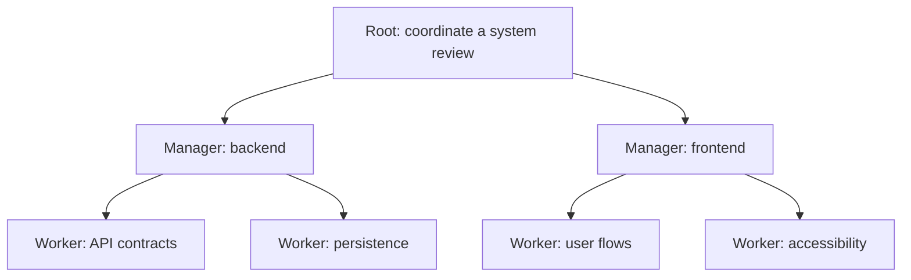

# Choosing an agent coordination workflow

This guide explains the multi-tier pyramid and the alternatives considered by
[choose-agent-workflow](SKILL.md). The skill recommends a setup; it does not launch agents
or implement that setup. The examples below are illustrative design choices, not measured
claims that one architecture always wins.

## What are you choosing?

Coordination answers three questions: who decides the next step, who owns the work, and
how results are combined and checked. More agents do not automatically mean better results.
Separate these dimensions:

- **Control:** predefined code, an agent making decisions, or a combination.
- **Structure:** one worker, a sequence, parallel branches, or a hierarchy.
- **State:** messages, durable artifacts, or a shared workspace.
- **Verification:** tests, evidence checks, human review, or a bounded review loop.

These dimensions can be combined. A script can run parallel agents, collect their files,
and invoke a reviewer. Anthropic similarly distinguishes predefined workflows from dynamic
agents and describes composable patterns in its
[Building effective agents guide](https://www.anthropic.com/engineering/building-effective-agents).

## Multi-tier pyramid: hierarchical delegation

A root orchestrator assigns broad areas to manager agents. Each manager delegates narrower
tasks to workers, integrates their results, and reports upward. The root owns the final result.

Arrows show delegation; evidence and results return up the same branches. A strict tree
routes cross-branch questions through managers. A practical implementation may also allow
direct messages or shared artifacts, provided responsibility remains clear.

**When it helps:** a delegated area needs its own planning, scheduling, and integration.
For example, the backend manager may need to reconcile findings across several services
before the root compares them with frontend assumptions.

**What it costs:** every layer adds instructions, handoffs, and opportunities to omit
requirements. Managers can duplicate analysis or wait on slow branches. Parallel workers
still compete for runtime capacity and API limits.

**How to keep it bounded:** define ownership, preserve original requirements and evidence
references, and cap delegation depth, concurrency, and total effort. Require managers to
report unresolved conflicts rather than hide them in a polished summary. Add depth where
needed instead of forcing every branch through the same number of tiers.

Separate context windows can reduce the material each agent must handle, but they are not
necessarily empty contexts or security sandboxes. Model selection and tool restrictions
depend on the runtime; a role description alone does not enforce permissions.

## Alternatives

### One agent with tools and selective context

**Shape:** goal → agent ↔ tools → result.

One agent reasons, gathers evidence, and makes changes. Skills provide relevant instructions
when needed; retrieval and durable notes help manage context.

Use this for tightly coupled debugging, small changes, or tasks where preserving one coherent
understanding matters. It avoids handoff overhead, but work may remain serial and context
management still requires care. Notes and compaction can lose details.

**Example:** investigate a failing integration test, fix the cause, and rerun the relevant checks.

### Code-driven workflow or DAG

**Shape:** inputs → scheduled steps → model calls where needed → validation → output.

A DAG is a directed acyclic graph: steps run after their dependencies finish, with independent
steps eligible to run concurrently. Explicit retry or revision loops can surround DAG stages.

Use this when processing steps are known and repeated. Code can implement checkpoints,
caching, retries, and audit records, but those features must be built; they are not automatic.
Repeatable orchestration also does not make model outputs deterministic.

**Example:** enumerate image batches, ask a model to triage each batch, validate structured
results, and aggregate flagged frames. Ordinary code should handle tasks that need no model
judgment. Use stable item identifiers and avoid duplicating side effects on retries.

### Flat fan-out with one integration owner

**Shape:** coordinator → independent workers → coordinator integrates.

Use this when tasks can be scoped independently and one coordinator can combine the results.
It removes intermediate managers but can overload the coordinator with raw output or
contradictory findings. Give each worker a clear question and require evidence-bearing results.

**Example:** review several independent modules, then combine findings into one prioritized report.

Anthropic's research system illustrates lead-agent coordination of parallel specialists;
its reported results are specific to its research workload and evaluation, not a universal
speed or quality guarantee. See its
[multi-agent research system report](https://www.anthropic.com/engineering/multi-agent-research-system).

### Sequential pipeline

**Shape:** research → draft → review → revise.

Use this when each stage transforms a defined artifact. Stages may be code, model calls,
or agents; a separate autonomous agent is not required for each box. Define what each stage
accepts and produces, and check artifacts before passing them onward.

Dependent stages cannot run simultaneously for the same item, though different items can
move through the pipeline concurrently. A bad early artifact can contaminate later stages.

**Example:** extract facts from documents, normalize records, then generate a report.

### Generator and verifier loop

**Shape:** produce → check → accept, revise, or escalate.

This is a quality mechanism that can be added to other architectures. Use explicit criteria
and objective tests or source evidence where possible. A separate reviewer can provide a
different perspective, but it can also repeat the generator's mistakes.

**Example:** generate a patch, run tests, review requirements, and return specific defects.
Bound the revision attempts and report remaining failures. Generating multiple candidates
and choosing one is another option, but its value depends on a reliable judge and enough budget.

### Shared workspace or blackboard

**Shape:** specialists ↔ structured shared state; an owner resolves conflicts.

Use this when specialists repeatedly need each other's evolving findings. This is a state
coordination mechanism that can support a flat team or a hierarchy.

A useful board records task ownership, status, artifact versions, dependencies, and decisions.
A directory containing everyone's output is insufficient if nobody knows which version is
authoritative. Choose conflict controls appropriate to the system: isolated branches,
single-writer ownership, transactions, or explicit merge rules.

**Example:** API and frontend specialists coordinate against a versioned interface contract.
Keep an integration owner and test both sides together before accepting the result.

### Routing and peer handoffs

**Shape:** intake → relevant specialist → another specialist when needed.

Routing selects an appropriate handler; a peer network allows specialists to transfer
responsibility directly. Neither implies that all agents run concurrently.

Use this when different request categories need different expertise. Record who currently
owns the request, preserve relevant state, and bound handoffs to prevent routing loops.
Broad all-to-all collaboration can become difficult to trace and reconcile.

**Example:** classify a support request, route it to billing or technical support, and transfer
ownership if the diagnosis changes. Keep escalation and completion conditions explicit.

## Quick comparison

| Task characteristic | Starting point | Watch for |
| --- | --- | --- |
| Small or tightly coupled task | One agent | Context growth and serial work |
| Known repeated steps | Code-driven workflow | Maintenance and retry correctness |
| Independent work packages | Flat fan-out | Overlap and aggregation overload |
| Ordered transformations | Sequential pipeline | Error propagation |
| Quality bottleneck | Add verification | Weak judging and endless revisions |
| Frequently changing shared information | Add a shared workspace | Stale state and conflicting writes |
| Subtasks need their own coordination | Bounded pyramid | Handoff overhead and information loss |
| Requests need different specialists | Routing or handoffs | Misrouting and unclear ownership |

Parallel reads with one integration owner are a useful engineering default. Parallel edits
can also work when files or branches are isolated, interfaces are agreed, and integration
checks exist. The dependency structure matters more than the number of files or agents.

## A practical choice process

1. Define the deliverable and acceptance criteria.
2. Identify the bottleneck and the dependencies between subtasks.
3. Start with the simplest setup that can meet those criteria.
4. Add concurrency for independent work, verification for quality, or hierarchy for genuine
   coordination load. These solve different problems.
5. Compare on representative tasks using the same acceptance criteria. Measure total cost,
   elapsed time, quality, and human intervention, including retries and integration work.

For example, a repeated dataset audit might use a code-driven batch workflow plus verification.
An unfamiliar bug might need one agent. A cross-system audit might start with flat reviewers
and add a manager only for the area whose internal dependencies require it.

## Handoffs that preserve useful context

For any delegated task, pass the original goal, relevant constraints, scope, dependencies,
allowed actions, and completion criteria. Ask for a concise result containing:

- Findings and the evidence supporting them.
- Artifact locations and versions where details can be retrieved.
- Assumptions, unresolved issues, and dependencies on other work.
- Checks performed, their results, and what remains unverified.

Keeping details in artifacts reduces pressure on the coordinator's context, but somebody
must inspect the evidence that matters. Assign responsibility for resolving conflicting
results and accepting the final deliverable.

## Using this skill

Example request:

> Use $choose-agent-workflow to recommend how to audit 20 modules. Most are independent,
> but four share an API. I care more about finding defects than finishing quickly.

Expect a recommended setup, reasons, responsibilities and checks, the main trade-off, and
conditions for changing the setup. The skill remains advisory until you separately request
implementation or execution.
